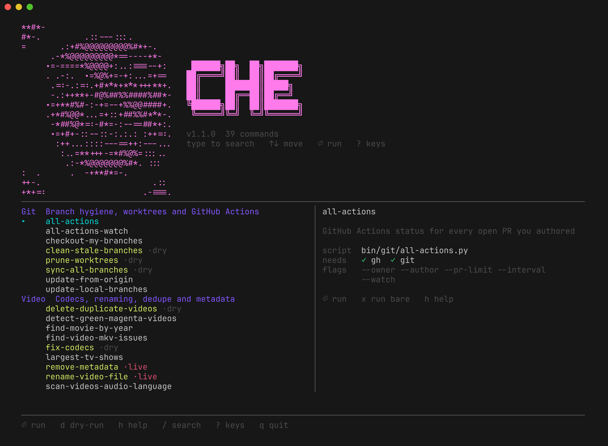
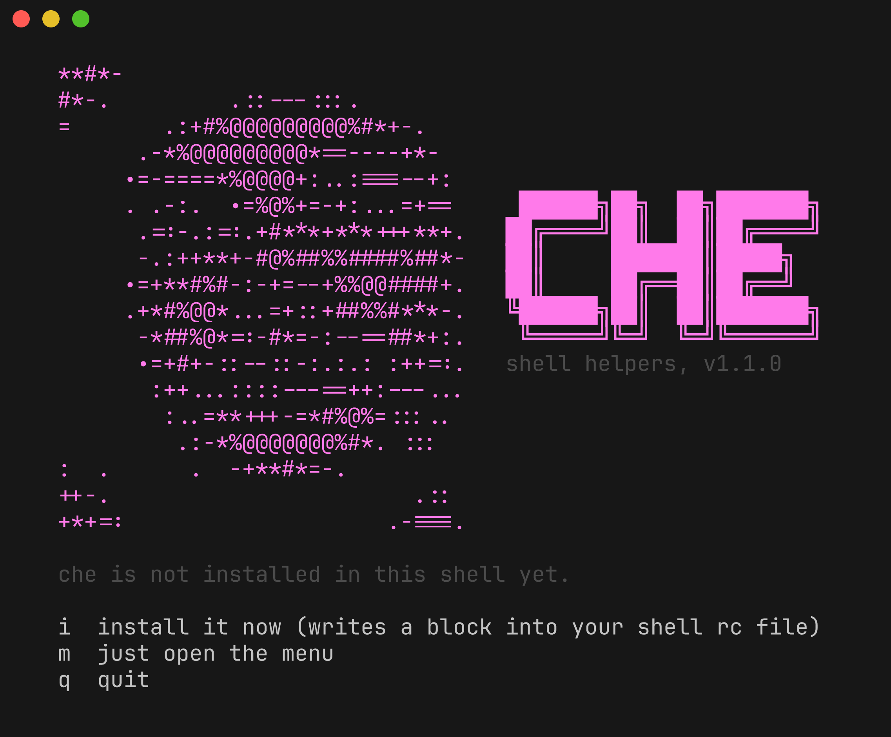
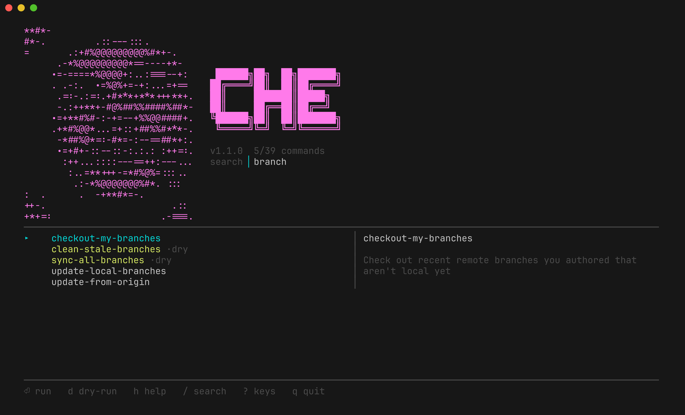
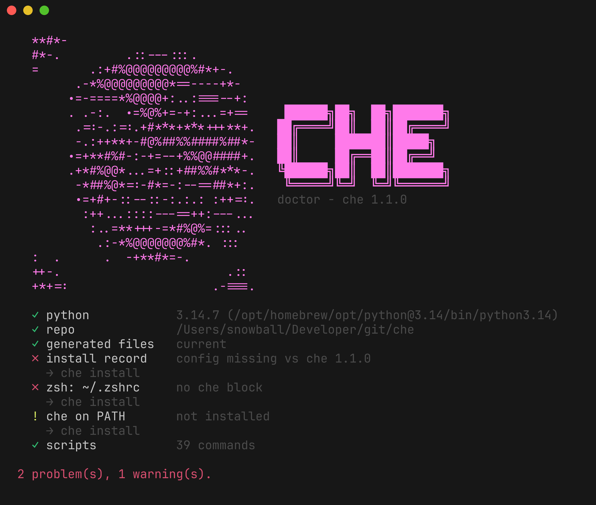

<div align="center">

# `che`

**Personal helper scripts, shared across machines, called by name from your
shell and browsable through one menu.**

[](https://github.com/codebend3r/che/actions/workflows/sanity-check.yml)
[](https://www.npmjs.com/package/@codebend3r/che)


[](LICENSE)

</div>

<!-- che:banner -->
```text
**#*-
#*-.         .::---:::.
=       .:+#%@@@@@@@@@%#*+-.
      .-*%@@@@@@@@@*==----+*-
     .=-====*%@@@@+:..:===--+:
     . .-:.  .=%@%+=-+:...=+==
      .=:-.:=:.+#***+***+++**+.    ██████╗██╗  ██╗███████╗
      -.:++**+-#@%##%%####%##*-   ██╔════╝██║  ██║██╔════╝
     .=+**#%#-:-+=--+%%@@####+.   ██║     ███████║█████╗
     .+*#%@@*...=+::+##%%#***-.   ██║     ██╔══██║██╔══╝
      -*##%@*=:-#*=-:--==##*+:.   ╚██████╗██║  ██║███████╗
      .=+#+-::--::-:.:.: :++=:.    ╚═════╝╚═╝  ╚═╝╚══════╝
       :++...::::---==++:---...
        :..=**+++-=*#%@%=:::..
         .:-*%@@@@@@@%#*. :::
:  .      .  -+**#*=-.
++-.                       .::
+*+=:                    .-===.
```
<!-- /che:banner -->

<div align="center">

</div>

<br>

`che` is a set of standalone Python scripts for git housekeeping, media
libraries, file cleanup, NAS drives and system upkeep. Each one is installed
as a shell function in zsh, bash and fish, and all of them can be browsed,
filtered and run from a full-screen terminal menu.

<!-- che:count -->
34 commands across 5 categories, plus 6 built into `che` itself
<!-- /che:count -->

## Contents

- [Features](#features)
- [Quick start](#quick-start)
- [Installation](#installation)
- [Usage](#usage)
- [Commands](#commands)
- [Configuration](#configuration)
- [External tools](#external-tools)
- [Development](#development)
- [Troubleshooting](#troubleshooting)
- [License](#license)

## Features

- **One manifest, everything generated.** Wrappers, completions, the menu, the
  doctor report and the tables in this README all come from
  `bin/commands.py`. CI fails if any of them drift.
- **Safe by default.** Destructive commands preview unless told otherwise, and
  each has a `-dr` twin that only prints. The menu opens on the dry run.
- **Standard library only.** Any Python 3.12+ runs everything. No virtualenv,
  no `pip install`.
- **Your dotfiles stay yours.** The installer writes a few lines between
  markers, backs up every rc file first, and never touches anything outside
  them.
- **Self-diagnosing.** `che doctor` checks the interpreter, generated files, rc
  blocks, external tools and alias collisions, and exits non-zero on failure.

## Quick start

```sh
curl -fsSL https://raw.githubusercontent.com/codebend3r/che/main/install.sh | bash
exec $SHELL
```

```sh
che                       # browse everything: type to filter, Enter to run
che <command> [args…]     # run one command directly
delete-by-ext --path=…    # or call any command by name
```

## Installation

### Requirements

- **Python 3.12 or newer.** The installer picks the newest suitable interpreter
  it can find and records its path, so an old system `python3` is fine as long
  as a newer one exists (`brew install python@3.13` if not).
- **zsh, bash or fish.**
- Some commands need external tools such as `ffmpeg` or `gh`; see
  [External tools](#external-tools).

### Install methods

**From a clone**

```sh
git clone https://github.com/codebend3r/che.git ~/Developer/git/che
~/Developer/git/che/install.sh
```

**One-liner** (clones into `~/Developer/git/che`, or `$CHE_HOME` if set)

```sh
curl -fsSL https://raw.githubusercontent.com/codebend3r/che/main/install.sh | bash
```

**From npm**

```sh
npm install -g @codebend3r/che
che                       # offers to install the shell wrappers on first run
```

> [!NOTE]
> Install the npm package globally rather than running it through `npx`: the
> wrappers point back at the package's location, and the `npx` cache is
> temporary. Update with `npm install -g @codebend3r/che@latest`; `che update`
> only works in a git clone.

### First run

`install.sh` finds a suitable Python and hands over to a short wizard. It
lists the shells it found and the rc files it would touch, asks whether to put
`che` on `PATH` and whether to keep the completion chimes, offers to remove
hand-written wrappers from before the installer existed, and reports missing
external tools (offering to `brew install` them when Homebrew is present).

<div align="center">

<br>
<em>Running <code>che</code> before installing offers to set itself up.</em>
</div>

### Unattended install

Any question answered on the command line is not asked again
(`--no-sounds`, `--no-path-shim`, `--replace-legacy`, `--install-deps`).

```sh
./install.sh --yes                     # install into every detected shell
./install.sh --yes --shells=zsh,fish   # or only the shells you name
./install.sh --dry-run                 # report what would change, write nothing
./install.sh --yes --replace-legacy    # also remove pre-che hand-written wrappers
./install.sh --print                   # print the rc block and exit
```

### What gets installed

| What | Where |
| --- | --- |
| The rc block | `~/.zshrc` (or `$ZDOTDIR/.zshrc`), `~/.bashrc` and `~/.bash_profile` (whichever exist), `~/.config/fish/config.fish`, and `~/.profile` only when `sh` is requested |
| Shell wrappers | `shell/che.zsh`, `shell/che.bash`, `shell/che.fish` in the repo |
| Tab completions | `shell/completions/`, sourced by the wrapper file |
| A `che` executable for cron and scripts | `~/.local/bin/che` |
| Your installer answers | `~/.config/che/config.json` |
| rc file backups | `~/.config/che/backups/` |

The rc block is deliberately small, so upgrading `che` never rewrites your
dotfiles:

```zsh
# >>> che shell functions >>>
# Managed by `che install` (che 1.0.0). Edits here are overwritten.
export CHE_HOME=/Users/you/Developer/git/che
export CHE_PYTHON=/opt/homebrew/bin/python3
[ -r /Users/you/Developer/git/che/shell/che.zsh ] && . /Users/you/Developer/git/che/shell/che.zsh
case ":$PATH:" in *":/Users/you/.local/bin:"*) ;; *) PATH="/Users/you/.local/bin:$PATH" ;; esac
# <<< che shell functions <<<
```

Everything between the markers is rewritten on every install; everything
outside them is left alone. Reload your shell afterwards with `exec zsh`
(or `exec bash`, `exec fish`).

### Updating and uninstalling

```sh
che update              # pull the latest scripts and refresh the wrappers
che uninstall           # remove the rc block, the shim and the completions
che uninstall --purge   # also delete ~/.config/che and the menu's input history
```

Uninstalling leaves the repository in place; delete the directory to finish.

## Usage

### The menu

Run `che` with no arguments to open the menu. Type to filter; the right pane
shows the selected command's summary, script, required tools and flags.
Anything that can preview **previews by default**, so pressing Enter on
`delete-by-ext` shows what it would delete rather than deleting it.

<div align="center">

</div>

<!-- che:keys -->
| Key | Does |
| --- | --- |
| `↑ ↓ / j k` | move |
| `PgUp PgDn / g G` | jump |
| `⏎` | run (asks for arguments) |
| `x` | run with no arguments |
| `d` | toggle dry-run for this command |
| `h` | show the command's own --help |
| `/` | search, Esc to clear |
| `?` | this list |
| `q` | quit |
<!-- /che:keys -->

### From the shell

Every command is a plain shell function, so `type delete-by-ext` shows exactly
what it runs. Destructive commands have a `-dr` twin that only prints:

```sh
delete-by-ext --path=/Volumes/Media --ext=nfo,txt   # deletes
delete-by-ext-dr --path=/Volumes/Media --ext=nfo    # shows what it would delete
```

`che <command>` runs the same script with the same environment its wrapper
uses, and `che help <command>` prints that script's `--help`.

All scripts share the same CLI conventions:

- **Long flags only**, with `=` for values: `--path=/foo`, `--ext=nfo,txt`.
- **Booleans** accept a bare `--flag` or `--flag=true|false` (also
  `yes|no`, `1|0`, `on|off`). A bare flag never swallows the next argument.
- **`--help`** on every script.
- **A symlinked `--path` is refused.** Pass the real path to act on it.

## Commands

<!-- che:commands -->
| Command | Does | Preview |
| --- | --- | --- |
| **Git** | *Branch hygiene, worktrees and GitHub Actions* | |
| `all-actions` | GitHub Actions status for every open PR and every default branch |  |
| `all-actions-watch` | Same as all-actions, refreshed on an interval |  |
| `checkout-my-branches` | Check out recent remote branches you authored that aren't local yet |  |
| `clean-stale-branches` | Delete local branches whose upstream is gone | `clean-stale-branches-dr` |
| `hard-reset-all-branches` | Check out every local branch and hard reset it to origin/<branch> | `hard-reset-all-branches-dr` |
| `prune-worktrees` | Remove every linked worktree, then prune stale admin records | `prune-worktrees-dr` |
| `sync-all-branches` | Update every branch and worktree, pruning what has been merged | `sync-all-branches-dr` |
| `update-from-origin` | Alias of sync-all-branches | `--dry-run` |
| `update-local-branches` | Rebase every local branch that has an upstream onto origin | `--dry-run` |
| **Video** | *Codecs, renaming, dedupe and metadata* | |
| `show-codecs` | Report media files outside the Direct Play codec/container set |  |
| `fix-codecs` | Re-encode media to h265/aac mp4 so it Direct Plays | `fix-codecs-dr` |
| `find-video-mkv-issues` | Scan MKV files and estimate Plex direct-play compatibility |  |
| `validate-video-files` | Check .mp4/.mkv files decode by playing one frame with mpv |  |
| `scan-videos-audio-language` | Print the audio language tags of every video under a path |  |
| `remove-metadata` | Strip all metadata from video files recursively | none |
| `rename-video-file` | Title-case video filenames (and optionally their folders) | `--dry-run` |
| `delete-duplicate-videos` | Delete duplicate MKV/MP4 files under a root directory | `delete-duplicate-videos-dr` |
| `video-list` | List .mp4/.mkv files under a path with human-readable sizes |  |
| `detect-green-magenta-videos` | Detect videos with the green/magenta chroma artifact |  |
| `find-movie-by-year` | Find movie folders whose name ends with "(YYYY)" |  |
| `largest-tv-shows` | Rank TV show folders in a library by total size on disk |  |
| **Files** | *Delete, compress and inspect by size or extension* | |
| `delete-by-ext` | Delete files under a path matching a set of extensions | `delete-by-ext-dr` |
| `delete-empty-folders` | Delete truly-empty directories under a path, cascading upwards | `delete-empty-folders-dr` |
| `delete-smb-files` | Delete .smbdelete* files left behind by an SMB share | `delete-smb-files-dr` |
| `files-under-size` | Find video files at or under a size threshold | `files-under-size-dr` |
| `find-largest-files` | List the largest files under a path, biggest first |  |
| `make-alpha-dir` | Create '#' and A-Z bucket folders under a parent directory |  |
| `compress-folders` | Zip every immediate subfolder of a path at max compression | `--dry-run` |
| `list-permission` | Show ownership and mode of a volume under /Volumes |  |
| **Drives** | *Mount, eject and keep-alive for the NAS volumes* | |
| `mount-all-drives` | Mount all NAS drives over SMB via AppleScript |  |
| `eject-all-drives` | Eject all NAS volumes from /Volumes | `eject-all-drives-dr` |
| `ping-nas` | Keep-alive pinger that remounts a NAS drive that dropped off |  |
| **System** | *Homebrew, monitoring and the machine itself* | |
| `update-brew` | Update Homebrew, upgrade formulae and casks, then clean up | `update-brew-dr` |
| `btop` | Launch btop with a gruvbox theme matching the macOS appearance |  |
<!-- /che:commands -->

Two commands have no `-dr` twin. `remove-metadata` cannot preview, since
exiftool rewrites files in place. `rename-video-file` already defaults to
`--dry-run=true`, so the real rename is the one that needs `--dry-run=false`.

### Built-in commands

<!-- che:builtins -->
| Command | Does |
| --- | --- |
| `che install` | Install the shell wrappers into your shell startup files |
| `che update` | Pull the latest scripts and refresh the installed wrappers |
| `che doctor` | Check the install, the interpreter and every external tool |
| `che uninstall` | Remove the wrappers, the shim and the completions |
| `che list` | List every command, one per line |
| `che completions` | Print the completion script for a shell |
<!-- /che:builtins -->

`che doctor` checks the interpreter, the repository, whether generated files
are current, whether each rc file has the block, whether `che` is on `PATH`,
every external tool, and anything shadowing a wrapper. It exits non-zero on a
real failure, so it can serve as a health check; `che doctor --json` gives
machine-readable output.

<div align="center">

<br>
<em>Every problem <code>che doctor</code> reports comes with the command that fixes it.</em>
</div>

### Syncing branches

`sync-all-branches` (alias `update-from-origin`) fetches once, deletes the
branches merged into a main or dev branch, rebases every other local branch
onto its upstream the way `git pull --rebase` does (falling back to
`origin/<branch>`), and tracks every origin feature branch that is not local
yet. Because it rebases from the upstream's fork point, a branch force-pushed
from another machine replays only the commits made here.

```sh
sync-all-branches       # update every branch and worktree
sync-all-branches-dr    # preview against cached remote refs; no fetch, no changes
```

- **Worktrees update in place.** Branches checked out in other worktrees,
  including locked ones, rebase inside their own checkout. Unoccupied branches
  use temporary worktrees, so your current checkout never switches.
- **Local work is preserved.** Uncommitted tracked and untracked changes are
  stashed and restored with their staged state; existing stashes are
  untouched. Dirty submodules and in-progress Git operations are reported and
  left alone.
- **No local change is discarded.** It never pushes. A branch is only moved
  or deleted when Git can prove its changes already exist elsewhere:
  - A diverged branch whose changes are all in its upstream (a stale copy of
    a branch rebased and force-pushed from another machine, typically after
    its parent was squash-merged) moves to the upstream instead of replaying
    commits that would conflict.
  - A branch proven merged into `origin/main`, `master`, `dev` or `develop`
    is deleted with its worktree: contained in it, its content already there
    (squash merges included), or a merged GitHub PR. When its upstream still
    exists, that must be merged too. The tip SHA is printed so you can restore
    it. A lock is dropped, an operation in progress is aborted and uncommitted
    work is stashed (its stash ID is printed) before the worktree goes; only
    your current checkout is kept. A missing upstream alone is not treated as
    merged: an unproven one is listed as `Upstream gone` and kept.
- **Failures are isolated.** A rebase conflict is aborted and reported while
  other branches continue, and any blocked branch makes the command exit
  non-zero. If restoring work conflicts, the recovery stash ID and worktree
  path are printed.
- Every origin feature branch that is not local and not merged becomes a
  local tracking branch (`--author=EMAIL` limits it to one author's).
- A temporary checkout left by an interrupted earlier sync is cleared first,
  so its half-done rebase no longer blocks the branch.

Like every branch-touching script in `bin/git/`, it disables repository hooks
for its own Git commands. The legacy `--no-push` and `--keep-locked` flags are
still accepted and ignored.

## Configuration

| Variable | Effect |
| --- | --- |
| `CHE_HOME` | Where the repository lives. Set by the rc block; the wrapper file falls back to its own location. |
| `CHE_PYTHON` | The interpreter the wrappers use. Set by the rc block to the one the installer verified. |
| `CHE_SOUNDS` | Set to `0` to turn off the `playsound-N` chime after each command. |
| `DRY_RUN` | Set explicitly by the wrappers on every call, so exporting it only affects scripts run directly. |
| `NO_COLOR` | Disables color in every script and in the menu. |

## External tools

Scripts that shell out to an external tool fail with an install hint when it
is missing, and `che doctor` reports which are present.

<!-- che:tools -->
| Tool | Needed by |
| --- | --- |
| `brew` | `update-brew` |
| `btop` | `btop` |
| `diskutil` | `eject-all-drives` |
| `exiftool` | `remove-metadata` |
| `ffmpeg` | `fix-codecs` |
| `ffprobe` | `show-codecs`, `find-video-mkv-issues`, `scan-videos-audio-language` |
| `gh` | `all-actions`, `all-actions-watch` |
| `git` | `all-actions`, `all-actions-watch`, `checkout-my-branches`, `clean-stale-branches`, `hard-reset-all-branches`, `prune-worktrees`, `sync-all-branches`, `update-from-origin`, `update-local-branches`, `update` |
| `mpv` | `validate-video-files` |
| `osascript` | `mount-all-drives` |
| (not a binary) | `detect-green-magenta-videos` needs OpenCV in ~/.venvs/green-magenta (override with $DETECT_GM_PYTHON) |
<!-- /che:tools -->

`diskutil` and `osascript` ship with macOS. The rest are a `brew install`
away, and `che install --install-deps` installs them for you.

`playsound-N`, the chime played when a wrapper finishes, is defined outside
this repository; the wrappers skip it silently when it is absent.

## Development

`bin/commands.py` is the single source of truth. The wrappers, completions,
menu, doctor report and this README's tables are all generated from it.

### Adding a command

1. Write the script under `bin/<category>/` and `chmod +x` it.
2. Add a `Command(...)` to `bin/commands.py`: name, summary, script, sound,
   preview style, required tools, flags, and the two or three questions the
   menu should ask.
3. Run `bun run generate` to rewrite `shell/` and the README tables, and
   commit the result.
4. Run `che update` on each machine.

Conventions for new scripts are documented at the top of `bin/utils.py` and in
[`CLAUDE.md`](CLAUDE.md).

### Project layout

```
bin/
  che.py          dispatcher, and the loop that runs what the menu picks
  commands.py     command manifest: the source of truth for everything
  menu.py         the menu's model, keys and drawing
  shellgen.py     renders wrappers, completions and README tables
  install.py      installer, first-run wizard, self-update, uninstall
  doctor.py       `che doctor`
  rcfile.py       rc file edits: the che block and legacy wrappers
  machine.py      shells, rc paths, python discovery, install record
  tui.py          terminal primitives: raw input, frame buffer, prompts
  art.py          the wordmark and banner
  utils.py        shared library: logging, arg parsing, subprocess, files
  gitutils.py     git helpers: worktrees, main branch, hook skipping
  branchsync.py   per-branch sync used by sync-all-branches
  media.py        ffprobe helpers for the video scripts
  nas.py          NAS drive table and SMB mounting
  git/  video/  files/  drives/  system/    the scripts, by category
shell/            GENERATED wrappers and completions (do not edit)
test/             pytest suites
install.sh        bootstrap for a bare machine
```

### Testing

The repository uses [Bun](https://bun.sh) as its task runner and
[uv](https://docs.astral.sh/uv/) for dev tooling, so neither `pytest` nor
`ruff` needs to be installed globally. Versions are pinned in
`requirements-dev.txt`.

```sh
bun run test        # pytest
bun run generate    # rewrite shell/ and the README tables from the manifest
bun run ci          # ruff, exec bits, shebangs, pytest; fails on stale generated files
```

> [!TIP]
> Use `bun run test`, not `bun test`, which runs Bun's built-in JavaScript
> test runner instead.

## Troubleshooting

<details>
<summary><strong>A command still runs the old version</strong></summary>

An alias beats a function in zsh and bash. The wrappers preserve any colliding
alias, so it keeps winning at the prompt. Run `\name` to reach the wrapper, or
remove the alias. `che doctor` lists every collision.

</details>

<details>
<summary><strong><code>che: command not found</code> in a script or cron job</strong></summary>

Non-interactive shells never read an rc file. Use `~/.local/bin/che`, which
the installer puts on `PATH`.

</details>

<details>
<summary><strong>A wrapper is missing after an update</strong></summary>

`che update` regenerates and reinstalls the wrappers. `che doctor` reports
whether `shell/` is stale or the rc block is out of date.

</details>

<details>
<summary><strong>Old hand-written wrappers are still in an rc file</strong></summary>

`che doctor` counts them, and `che install --replace-legacy` removes them,
along with their helpers and the lines that called them, after a backup.

</details>

## History

These scripts were written in bash until August 2026, when they were ported to
Python. Every intentional behavioural difference from the bash originals is
commented at the line where it occurs, and `git log` holds the shell versions.

## License

[MIT](LICENSE) © CJ Rivas
